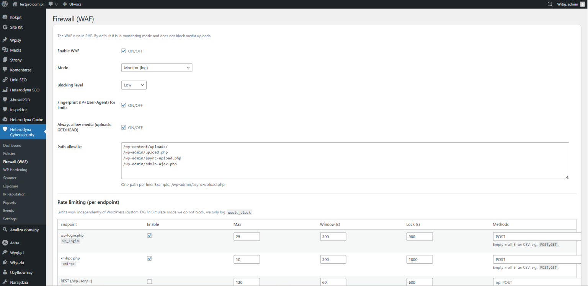

# Heterodyna Cybersecurity

### Kompleksowa ochrona WordPress przed zagrożeniami

[**Pobierz wtyczkę**](http://testpro.com.pl/wp-content/uploads/2026/04/heterodyna-cybersecurity-2-1.zip)

**Heterodyna Cybersecurity** to zaawansowana wtyczka bezpieczeństwa dla WordPress, która chroni stronę przed atakami, wykrywa zagrożenia i reaguje w czasie rzeczywistym.

To nie jest tylko firewall — to **aktywny system obrony**.

---

## 🔥 Co wyróżnia tę wtyczkę?

Heterodyna Cybersecurity pomaga działać zanim dojdzie do włamania. Analizuje ruch i zachowanie użytkowników, blokuje podejrzane działania automatycznie i daje kontrolę nad bezpieczeństwem strony.

---

## ⚙️ Główne funkcje

### 🛡️ Ochrona przed atakami

Wtyczka pomaga blokować próby brute-force, chronić logowanie WordPress oraz filtrować podejrzane adresy IP.

### 🔍 Monitoring i analiza

Udostępnia logi bezpieczeństwa w czasie rzeczywistym, analizę ruchu użytkowników i wykrywanie nietypowych zachowań.

### 🚫 Firewall aplikacyjny (WAF)

Pozwala monitorować i filtrować złośliwe zapytania, ograniczać aktywność botów i skanerów oraz chronić stronę przed próbami wykorzystania podatności.

### 🧠 Inteligentne wykrywanie zagrożeń

Analizuje wzorce ataków i anomalie, dzięki czemu łatwiej zauważyć podejrzane działania i szybciej na nie reagować.

### 🔐 Ochrona WordPress

Pomaga ograniczać dostęp do wrażliwych obszarów WordPressa, chronić endpointy i zmniejszać ilość ujawnianych informacji o środowisku.

---

## ⚡ Dlaczego warto?

Wszystkie najważniejsze informacje i ustawienia bezpieczeństwa są dostępne w jednym miejscu. Wtyczka pozwala monitorować stronę, reagować na podejrzane zdarzenia i ograniczać typowe próby ataków bez konieczności ręcznego składania kilku osobnych narzędzi.

---

## 🎯 Dla kogo?

Heterodyna Cybersecurity jest przeznaczona dla właścicieli stron WordPress, administratorów, osób prowadzących biznes online oraz wszystkich, którzy chcą mieć lepszy wgląd w bezpieczeństwo swojej strony.

---

## 🔧 Zastosowanie

Wtyczka może być używana do ochrony stron firmowych i blogów, zabezpieczania sklepów WooCommerce, monitorowania prób włamań oraz analizy zdarzeń bezpieczeństwa.

---

## Wersja

Aktualna wersja kodu: **01.001.0010**

W nagłówku wtyczki i w stałej `HCYB_VERSION` znajduje się ten sam numer wersji.

## Autor

**Heterodyna Team Software**  
https://heterodynateamsoftware.pl
